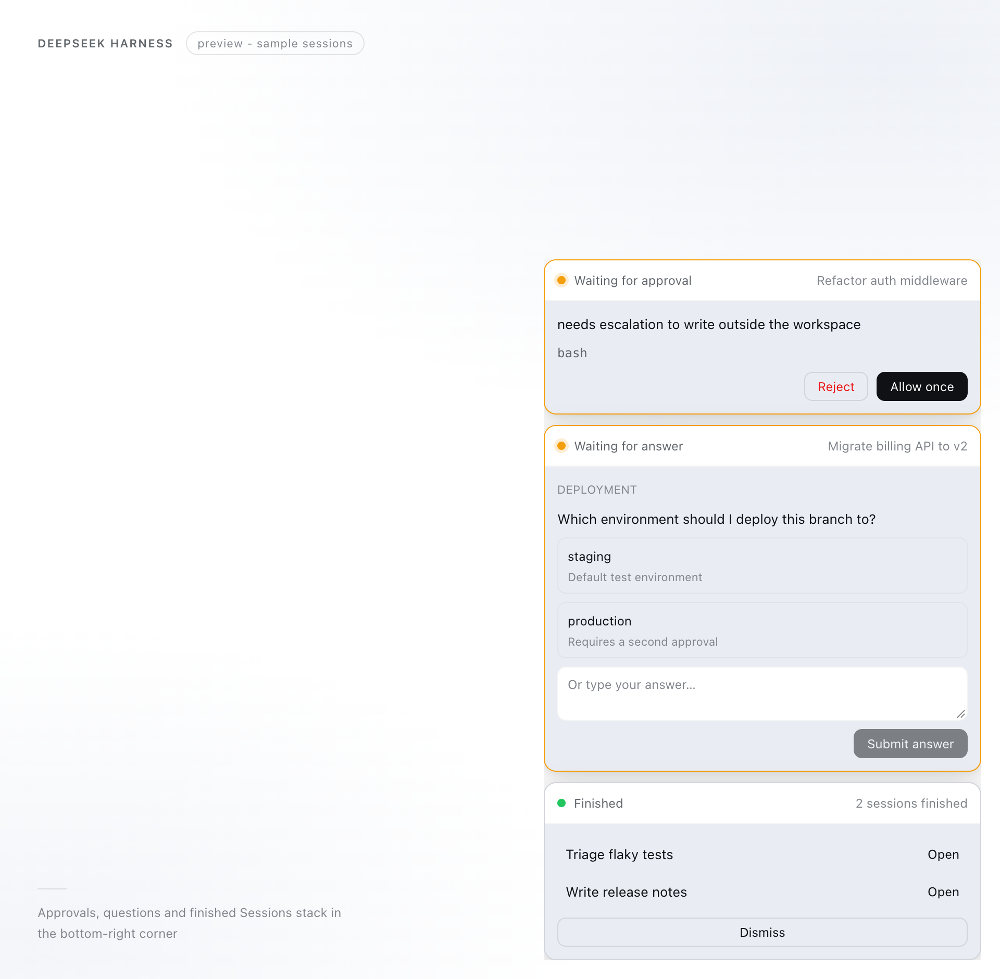
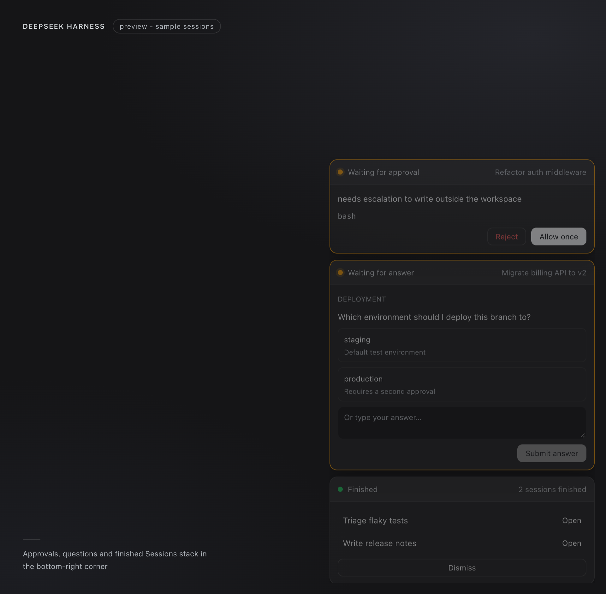

# dsh-approval-popups

Cross-session approval, question and completion popups for the DeepSeek Harness Web UI: answer a background Session's request from the bottom-right corner of the conversation you are already in.


English | [中文](https://github.com/kevinxcw/dsh-approval-popups/blob/main/docs/README.zh.md)

> **Status: 0.1.2 preview.** Built against DSH `0.2.2-rc.1`. It reads a few runtime fields that are not part of the public pending-interaction type; see [Known limitations](#known-limitations).



*Sample Sessions rendered with the real component; colors follow the active theme.*

## Why dsh-approval-popups

DSH already shows an approval or a question inside the Session that asked it, and marks that Session with a small dot in the sidebar. While you are deep in one conversation, that is easy to miss — and switching Sessions to check loses your place.

This plugin reads the same live session status the Web UI uses and mirrors it into one always-visible place: pending approvals, questions, plan reviews, and Sessions that finished while you were elsewhere. Answering a card settles the original request, so the other Session continues instead of waiting.

Not for you if you want operating-system notifications, a tray icon, or a desktop pet; see [Related projects](#related-projects).

## What you get

| Surface | Where | What you can do |
|---|---|---|
| Approval card | Bottom-right stack | Check the tool and its reason, then **Allow once** or **Reject**. |
| Question card | Bottom-right stack | Pick options, type a custom answer, **skip** individual questions, and submit the batch. |
| Plan review card | Bottom-right stack | Read the plan, then **Approve plan** or **Send back**. |
| Completion card | Bottom-right stack | Up to four finished Sessions, aggregated; **Open** one or **Dismiss** the notice. |
| Chime | Your speakers | Two synthesized notes for a new request; one softer note when a Session finishes. No audio file is shipped. |
| Theme and locale | Everywhere | Follows DSH light, dark, and third-party themes; the copy follows the UI language (English / 中文). |

Details that matter in daily use:

- **The Session on screen is not duplicated.** The shipped composer already shows its approval or question, so the stack hides that Session's pending card and leaves the decision there.
- **Answers are real answers.** Cards call the same pending object the composer uses, so the Host waterfall settles exactly once and the original card disappears together with this one.
- **Single-select questions** treat the custom field as the alternative answer: focusing it moves the selected look off the options (typed text is kept but inactive), and clicking an option takes it back. **Multi-select questions** submit the chosen options and the custom text together.
- **Tall stacks scroll.** Cards never get taller than `72vh`; the stack itself scrolls, and the page underneath stays clickable outside the cards.
- **Completion is the edge of `running`.** A Session that goes from running to idle is announced after a 1.6 s settle delay, skipping subagent Sessions, Sessions waiting for an interaction, and the Session you are looking at.

## Quick start

### 1. Install

**Plugin Manager (recommended).** In DSH, open **Plugins** in the sidebar, choose **Add plugin**, and paste the package name:

```text
dsh-approval-popups
```

The same install works from the CLI on a Web profile:

```sh
dsh plugin --profile web add dsh-approval-popups
```

Append `@0.1.2` to pin the registry version, or paste the release tarball URL instead — it is the same build:

```text
https://github.com/kevinxcw/dsh-approval-popups/releases/download/v0.1.2/dsh-approval-popups-0.1.2.tgz
```

DSH installs from the [npm registry](https://www.npmjs.com/package/dsh-approval-popups) or from the tarball; then enable the bundle if DSH leaves it switched off. Both routes ship the built Client bundle, so DSH does not run build scripts.

**From a checkout (developers).** Clone, build, then install the directory:

```sh
git clone https://github.com/kevinxcw/dsh-approval-popups.git
cd dsh-approval-popups
pnpm install
pnpm build
```

Then choose **Add plugin** → the absolute path of that checkout, or run:

```sh
dsh plugin --profile <profile> add link:/absolute/path/to/dsh-approval-popups
```

`<profile>` is the profile that runs the Web UI: `web` for `dsh web`, `desktop` for the desktop app. The desktop app manages its own profile; use its **Plugins** page rather than the bundled CLI there. If `dsh` is not on your `PATH`, the desktop app can register its bundled CLI from the **Manage dsh Command** menu.

### 2. Reload the page

This is a **Client-only** plugin: after the first install, refresh the page (⌘R / Ctrl+R). Host restart is not required. Later rebuilds are picked up by `dsh-client-hmr`.

Check that the bundle is active:

```sh
dsh --profile web --dump-config | grep -n -A3 dsh-approval-popups
```

### 3. Try it

Open a second Session and leave something pending there, then come back to your first conversation:

```text
Session B: run a bash command that needs approval, for example writing a file outside the workspace
→ Session A shows "Waiting for approval" in the bottom-right corner;
  click Allow once and Session B continues.
```

```text
Session B: ask for a task that runs for about a minute, then switch back to Session A
→ when Session B stops, a "Finished" card appears; Open jumps to it.
```

## Appearance

The same component in the dark theme — the card surface, primary button label, and hover states all come from theme tokens, so a third-party theme carries over too.



## Configuration

There is nothing to configure in 0.1.2: the plugin exports no `Config` schema, and `cordis.patch.yml` needs no `config:`. These values are fixed by design:

| Constant | Value | Why |
|---|---|---|
| Completion settle delay | 1.6 s | A pause between turns is not a finished Session. |
| Completion rows | 4 shown, 12 retained | Keeps the aggregated card short; older notices fall off. |
| Stack width | `min(420px, 100vw - 32px)` | Fits the card content without covering the composer on small windows. |
| Stack height | `72vh`, scrollable | A batch of questions stays reachable without pushing the first card off-screen. |
| Chime | Synthesized WebAudio, no asset | Browsers mute audio until the first click or keypress; notices before that stay silent. |

## Compatibility

| Item | Value |
|---|---|
| DSH | `0.2.2-rc.1` (`engines.dsh`; a mismatch is refused instead of loading half-working) |
| Node.js | `>=24.9.0` (inherited from the DSH runtime) |
| Distribution | npm [`dsh-approval-popups`](https://www.npmjs.com/package/dsh-approval-popups) and the GitHub release tarball |
| Half | Client-only; the Host `apply()` is intentionally empty |
| Tested on | macOS 26.6.2 (arm64), DSH Desktop + Web UI at 0.2.2-rc.1 |
| Interface language | English and 中文 |

The Web Client uses `light-dark()` when the browser supports it and a plain layer token otherwise; both paths are covered by the palette test in `test/render.smoke.mjs`.

## Permissions and safety

- **Reads:** the live `uiSession.sessionStatus` projection (running flag, pending interaction, completion flag), Session titles from the Client Session list, and the pending interaction objects of other Sessions.
- **Writes:** nothing. No files, no `localStorage`, no cookies, no settings.
- **Executes:** no shell commands, no subprocesses, no network requests.
- **Install-time network:** only while DSH installs or updates the plugin — it downloads the package from `registry.npmjs.org` (or the GitHub release URL you pasted). Once installed, the plugin makes no requests.
- **Credentials:** none.
- **Answers:** never sent until you click **Allow once**, **Reject**, **Submit answer**, **Approve plan**, or **Send back**. The answer travels through the Host's own pending object.
- **Audio:** a short synthesized tone through the browser's audio context; no file is downloaded.
- **Uninstall:** **Plugins** page → uninstall, or `dsh plugin --profile <profile> remove dsh-approval-popups`.
- **Left behind after uninstall:** nothing.

Unofficial plugin: not maintained by, or bundled with, DeepSeek Harness.

## Known limitations

- **Semi-public pending API.** The public `SessionPendingInteraction` type exposes `sessionId` and `kind`; `questions`, `toolName`, `reason`, `displayReason`, and `answer()` are runtime fields of the shipped pending objects. The plugin reads them defensively and falls back to "open the Session" when they are missing. Re-verify after every DSH upgrade.
- **Completion does not know the outcome.** Success, failure, and user interruption all surface as "Finished".
- **Page lifetime.** Sessions that finish while the Web UI is closed produce no notice.
- **Current workspace only.** Titles and navigation come from the Client Session list; a Session outside the current workspace falls back to an untitled label and may not open.
- **One visible interaction per Session.** The shipped projection elects a single interaction per Session by domain precedence, so an approval and a question pending at once appear one after another.
- **Multiple windows** each show their own stack; answering in one removes the card in the other on the next status publication.
- **Audio needs one interaction.** Under the browser autoplay policy, the chime is muted until you click or type once after loading the page.

## Troubleshooting

| Symptom | Likely cause | Fix |
|---|---|---|
| Plugin is listed but no cards appear | Every other Session is idle; the Session on screen is intentionally excluded | Trigger an approval or question in another Session and switch back. |
| `incompatible-version` or the bundle is refused | `engines.dsh` does not match the running DSH | Use DSH `0.2.2-rc.1`, or update the plugin to a release built for your version. |
| Install from a checkout fails with `Cannot find module .../lib/index.js` | `lib/` is not committed; the checkout was never built | Run `pnpm install && pnpm build` in the checkout, then install the directory again. |
| Submitting from a card shows "This version cannot submit from here" | The DSH upgrade renamed the runtime pending fields | Open the Session and answer in the shipped composer; update the plugin. |
| No sound after loading the page | Browser autoplay policy has not seen a click or keypress yet | Click anywhere in the page once; the next notice rings. |
| A rebuilt Client bundle does not show up | HMR did not reload, or the build output is stale | Run `pnpm build`, then refresh the page. |

## Development

```sh
pnpm install
pnpm build       # tsc for the Host entry, then copies src/client.js to lib/client.js
pnpm typecheck
pnpm test        # pretest builds, then runs 18 node:test cases
pnpm pack --dry-run
```

`src/client.js` is plain JavaScript on purpose: the Module Loader evaluates the bundle directly, and TypeScript is only used for the empty Host entry. The tests load the built bundle with a stubbed React/DOM and drive the session-status source, covering pending collection, completion debounce, subagent filtering, current-Session suppression, the multi-question layout, and the theme palette.

`lib/` is not committed. Build before installing a local checkout with `link:`; after that, Client-only changes are picked up by HMR or a page refresh. `pnpm pack --dry-run` should list `lib/`, `cordis.patch.yml`, `locale/*.json`, `README.md`, `docs/README.zh.md`, `LICENSE`, and `icon.svg`.

Releases go to both channels from the same build: bump `version`, run `pnpm build && pnpm test`, then `npm publish`, and attach the `pnpm pack` tarball to a GitHub release tagged `v<version>`.

## Related projects

- [AnLifeX/dsh-attention](https://github.com/AnLifeX/dsh-attention) — covers the same need from the Host side, with interactive cards, a desktop pet, and Windows system notifications. `dsh-approval-popups` is a smaller, Client-only overlay; pick that one if you want OS-level alerts.

## License

MIT. See [LICENSE](https://github.com/kevinxcw/dsh-approval-popups/blob/main/LICENSE).
