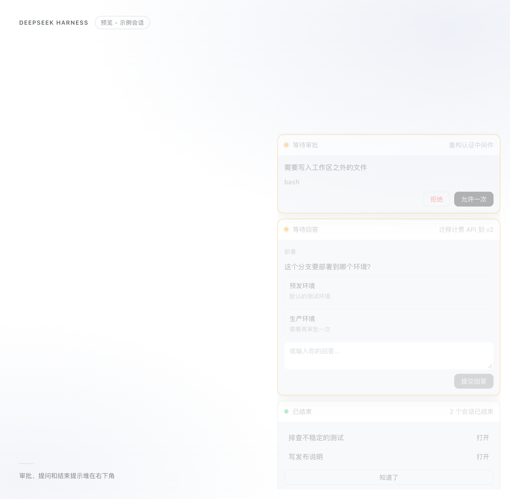
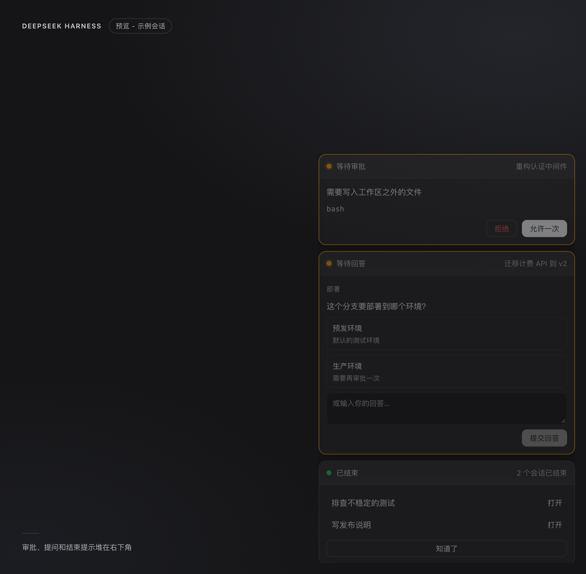

# dsh-approval-popups

给 DeepSeek Harness Web UI 加一组**跨会话提醒弹窗**：不用切走当前对话，就能在右下角处理后台会话的审批、提问和计划审阅，并看到刚刚跑完的会话。


[English](https://github.com/kevinxcw/dsh-approval-popups/blob/main/README.md) | 中文

> **状态：0.1.1 预览版。** 针对 DSH `0.2.2-rc.1` 构建。插件会读取少数尚未进入公开类型的运行时字段，见[已知限制](#已知限制)。



*示例会话 + 真实组件渲染；配色跟随当前主题。*

## 为什么需要它

DSH 会在发起请求的那个会话里显示审批或提问，并在侧边栏给该会话一个小黄点。但当你正专心看一个对话时，小黄点很容易被忽略；切过去处理又会打断当前上下文。

这个插件读取 Web UI 已有的实时会话状态，把另一份全局视图放到**始终可见的右下角**：待处理的审批、提问、计划审阅，以及你没在看时结束的会话。在卡片上回答后，请求会在原会话里正常结算，另一个会话继续跑，不会一直挂着。

如果你想要的是操作系统通知、托盘图标或桌面宠物，这个插件不适合你，见[相关项目](#相关项目)。

## 你会得到什么

| 界面 | 位置 | 可以做什么 |
|---|---|---|
| 审批卡片 | 右下角卡片堆 | 查看工具名和原因，选择**允许一次**或**拒绝**。 |
| 提问卡片 | 右下角卡片堆 | 选选项、输入自定义回答、逐题**跳过**，整批提交。 |
| 计划审阅卡片 | 右下角卡片堆 | 阅读计划，选择**批准计划**或**打回**。 |
| 结束提示卡片 | 右下角卡片堆 | 汇总最多 4 个刚刚结束的会话，**打开**其中一个，或**知道了**。 |
| 提示音 | 扬声器 | 新请求响两声合成音；会话结束响一声更轻的单音。不打包任何音频文件。 |
| 主题与语言 | 全局 | 跟随 DSH 的浅色、深色和第三方主题；文案跟随界面语言（中文 / English）。 |

几个日常使用中容易踩到的细节：

- **当前会话不重复弹。** 正在看的那个会话，原生输入区已经显示了同一个请求，所以卡片堆会隐藏它的待处理卡片，避免重复。
- **卡片上的回答就是正式回答。** 走的是 composer 卡片用的同一个 pending 对象，Host waterfall 只结算一次，原生卡片和这里会同时消失。
- **单选题**把自定义输入框当作「另一个选项」：点进输入框，选中态从选项移到输入框（已输入的文字保留但暂不生效）；再点选项，选中态移回去。**多选题**允许「选中的选项 + 自定义文字」一起提交。
- **卡片堆会滚动。** 卡片区最高 `72vh`，超出时在堆内滚动；卡片之外的页面区域保持点击穿透。
- **结束提示只看 `running` 的下降沿。** 会话从运行中变为空闲，等待 1.6 秒确认后提示；跳过 subagent、正在等待交互的会话，以及你正看着的会话。

## 快速开始

### 1. 安装

**用 Plugins 页面（推荐）。** 打开 DSH 侧边栏的 **Plugins / 插件** 页面，点 **Add plugin / 添加插件**，粘贴包名：

```text
dsh-approval-popups
```

同样的安装也可以走 CLI（Web profile）：

```sh
dsh plugin --profile web add dsh-approval-popups
```

加 `@0.1.1` 锁定 registry 版本；不想用 npm 的话，也可以直接粘贴 release 压缩包地址，两者是同一份构建：

```text
https://github.com/kevinxcw/dsh-approval-popups/releases/download/v0.1.1/dsh-approval-popups-0.1.1.tgz
```

DSH 会从 [npm registry](https://www.npmjs.com/package/dsh-approval-popups) 或压缩包安装；安装后如果插件处于关闭状态，手动启用。两种方式都包含构建好的 Client bundle，DSH 不需要执行构建脚本。

**从源码安装（开发者）。** 克隆、构建，然后安装目录：

```sh
git clone https://github.com/kevinxcw/dsh-approval-popups.git
cd dsh-approval-popups
pnpm install
pnpm build
```

然后在 **Add plugin / 添加插件** 里填这个目录的绝对路径，或执行：

```sh
dsh plugin --profile <profile> add link:/absolute/path/to/dsh-approval-popups
```

`<profile>` 是运行 Web UI 的 profile：`dsh web` 用 `web`，桌面应用用 `desktop`。桌面版管理的是它自己的 profile，请用应用里的 **Plugins / 插件** 页面，不要用自带 CLI 去改。如果 `dsh` 不在 `PATH` 里，可以在桌面版菜单的 **Manage dsh Command / 管理 dsh 命令** 里注册自带 CLI。

### 2. 刷新页面

这是**纯 Client half** 插件：首次安装后刷新页面（⌘R / Ctrl+R）即可，不需要重启 Host。之后的重新构建由 `dsh-client-hmr` 热替换。

确认 bundle 已启用：

```sh
dsh --profile web --dump-config | grep -n -A3 dsh-approval-popups
```

### 3. 试一下

新开第二个会话，在里面留一个待处理请求，然后回到第一个对话：

```text
在会话 B 里执行一条需要审批的 bash 命令，例如往工作区外写文件
→ 会话 A 右下角出现「等待审批」卡片；
  点「允许一次」，会话 B 继续执行。
```

```text
在会话 B 里让 Agent 跑一个大约一分钟的任务，然后切回会话 A
→ 会话 B 停下来后，右下角出现「已结束」卡片；点「打开」跳过去。
```

## 外观

同一个组件在深色主题下的样子——卡片底色、主按钮文字和 hover 态都取自主题 token，第三方主题也能跟着变。



## 配置

0.1.1 没有可配置项：插件不导出 `Config` schema，`cordis.patch.yml` 也不需要 `config:`。以下值是固定的：

| 常量 | 值 | 原因 |
|---|---|---|
| 结束确认延迟 | 1.6 秒 | 两轮对话之间的正常停顿不算「已结束」。 |
| 结束提示行数 | 显示 4 行，保留 12 条 | 汇总卡片保持简短，更旧的提示自动淘汰。 |
| 卡片堆宽度 | `min(420px, 100vw - 32px)` | 放得下卡片内容，小窗口下不盖住输入区。 |
| 卡片堆高度 | `72vh`，可滚动 | 多题审批一屏放不下时，第一张卡不会被挤出视口。 |
| 提示音 | WebAudio 实时合成，无音频文件 | 浏览器在首次点击/按键前会静音；之前的通知不发声。 |

## 兼容性

| 项 | 值 |
|---|---|
| DSH | `0.2.2-rc.1`（`engines.dsh`；版本不匹配会拒绝加载，而不是半可用） |
| Node.js | `>=24.9.0`（跟随 DSH 运行时） |
| 分发方式 | npm [`dsh-approval-popups`](https://www.npmjs.com/package/dsh-approval-popups) 与 GitHub release 压缩包 |
| 组成 | 纯 Client half；Host 的 `apply()` 故意留空 |
| 已验证环境 | macOS 26.6.2（arm64）、DSH Desktop 及其 Web UI，0.2.2-rc.1 |
| 界面语言 | 中文、English |

Web Client 在浏览器支持时使用 `light-dark()`，否则退回到普通层色 token；两条路径都有 `test/render.smoke.mjs` 里的配色测试覆盖。

## 权限与安全

- **读取：** 实时的 `uiSession.sessionStatus` 投影（运行标志、待处理交互、完成标志）、Client 会话列表里的会话标题，以及其它会话的 pending 对象。
- **写入：** 无。不写文件，不用 `localStorage`，不写 cookie，不改设置。
- **执行：** 不执行 shell，不起子进程，不发网络请求。
- **安装时联网：** 只在 DSH 安装或更新插件时发生——从 `registry.npmjs.org`（或你粘贴的 GitHub release 地址）下载包；安装完成后不再发任何请求。
- **凭据：** 不读取。
- **回答：** 只有你点击**允许一次**、**拒绝**、**提交回答**、**批准计划**或**打回**之后才会发出，且走 Host 自己的 pending 对象结算。
- **声音：** 浏览器音频上下文里合成的短音，不下载文件。
- **卸载：** **Plugins / 插件** 页面卸载，或 `dsh plugin --profile <profile> remove dsh-approval-popups`。
- **卸载残留：** 无。

非官方插件：不属于 DeepSeek Harness 官方发布，也不由官方维护。

## 已知限制

- **半公开的 pending API。** 公开类型 `SessionPendingInteraction` 只暴露 `sessionId` 和 `kind`；`questions`、`toolName`、`reason`、`displayReason`、`answer()` 都是原生 pending 对象的运行时字段。插件全程防御式读取，字段缺失时降级为「打开会话处理」。升级 DSH 后需要回归。
- **结束提示不区分结果。** 正常完成、报错、用户中断，统一显示「已结束」。
- **页面生命周期。** Web UI 关闭期间跑完的会话没有提示。
- **仅当前 workspace。** 标题和跳转来自 Client 会话列表；其它 workspace 的请求只能显示未命名标签，且可能跳不过去。
- **每个会话只显示一个交互。** 原生投影按 domain 优先级为每个会话选一个，审批和提问同时挂起时会逐个出现。
- **多窗口**各自有一份卡片堆；在一个窗口回答后，另一个窗口会在下一次状态发布时消失。
- **提示音需要一次交互。** 受浏览器自动播放策略限制，页面加载后没有点击/按键之前，提示音是静音的。

## 排错

| 现象 | 可能原因 | 处理 |
|---|---|---|
| 插件在列表里，但右下角没有卡片 | 其它会话都空闲；当前会话按设计不重复显示 | 在另一个会话里触发审批或提问，再切回来。 |
| 报 `incompatible-version` 或 bundle 被拒绝 | `engines.dsh` 与当前 DSH 不匹配 | 使用 DSH `0.2.2-rc.1`，或安装对应版本构建出的插件。 |
| 从源码安装报 `Cannot find module .../lib/index.js` | `lib/` 不提交，目录还没构建 | 先在目录里执行 `pnpm install && pnpm build`，再重新安装。 |
| 卡片提交时提示「当前版本不支持在此处提交」 | DSH 升级后改了 pending 的运行时字段 | 打开会话用原生卡片回答；然后升级插件。 |
| 页面加载后没有声音 | 浏览器还没看到点击/按键，音频被自动播放策略拦住 | 在页面任意位置点一下，之后的通知就会响。 |
| 重新构建后页面没变化 | HMR 没替换，或构建产物是旧的 | 先 `pnpm build`，再刷新页面。 |

## 开发

```sh
pnpm install
pnpm build       # 编译 Host 入口，并把 src/client.js 复制到 lib/client.js
pnpm typecheck
pnpm test        # pretest 先构建，再跑 18 个 node:test 用例
pnpm pack --dry-run
```

`src/client.js` 故意用纯 JavaScript：Module Loader 直接执行这个 bundle，TypeScript 只用于空的 Host 入口。测试用打桩的 React/DOM 加载构建产物，并驱动 session 状态源，覆盖待处理收集、完成防抖、subagent 过滤、当前会话抑制、多题布局和主题配色。

`lib/` 不提交。用 `link:` 安装本地目录前先构建；之后只改 Client 的改动由 HMR 或刷新页面生效。`pnpm pack --dry-run` 应包含 `lib/`、`cordis.patch.yml`、`locale/*.json`、`README.md`、`docs/README.zh.md`、`LICENSE` 和 `icon.svg`。

发布同时走两个渠道，共用同一份构建：先改 `version`，执行 `pnpm build && pnpm test`，然后 `npm publish`，再用 `pnpm pack` 的产物创建 `v<version>` 的 GitHub release。

## 相关项目

- [AnLifeX/dsh-attention](https://github.com/AnLifeX/dsh-attention) — 从 Host 侧解决同一类需求，带可交互卡片、桌面宠物和 Windows 系统通知。`dsh-approval-popups` 是更小的纯 Client 浮层；如果你要的是系统级提醒，选那个。

## 许可证

MIT。见 [LICENSE](https://github.com/kevinxcw/dsh-approval-popups/blob/main/LICENSE)。
